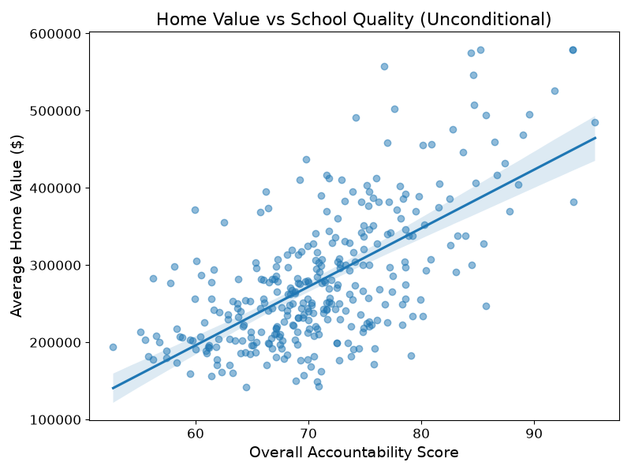
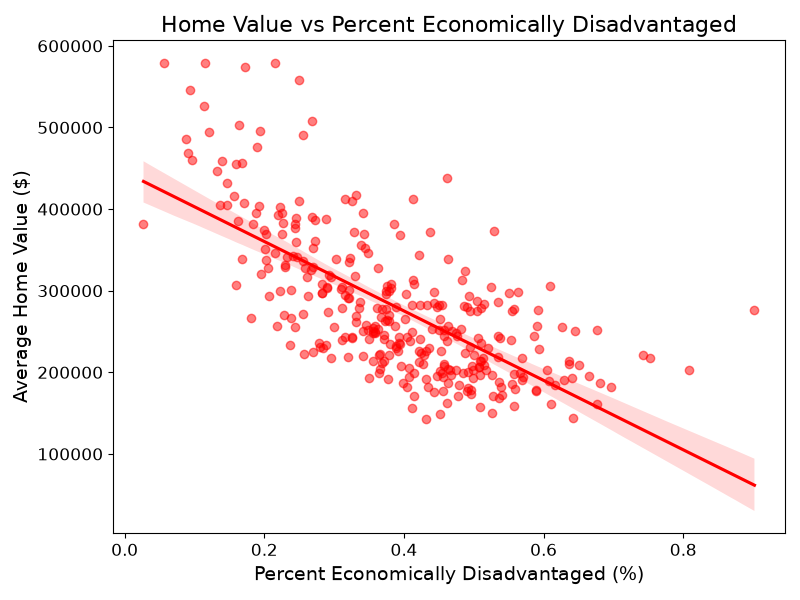

# School Quality and Home Values in Wisconsin

Team project that measures how strongly Wisconsin school-district quality is associated with local home values, and how much of that association goes away once district demographics are controlled for.

## Data

- **Wisconsin DPI 2024–25 District Report Cards** (`data/`): the Overall Accountability Score (the school-quality measure), the percentage of economically disadvantaged students, racial composition, and the percentage of students with disabilities.
- **Zillow Home Value Index (ZHVI)**, zip-level mid-tier single-family/condo, smoothed and seasonally adjusted. 2024 values are averaged to the city level and joined to districts by city. The file is too large for git, so download `Zip_zhvi_uc_sfrcondo_tier_0.33_0.67_sm_sa_month.csv` from [Zillow Research](https://www.zillow.com/research/data/) into `data/`.

## Method

OLS regressions with `statsmodels`:

1. Naive model: `HomeValue ~ Score`
2. Controlled model: `HomeValue ~ Score + Econ_Disadv + Pct_White + Pct_Disabilities`

The controls address omitted-variable bias. Neighborhood income drives both home prices and school outcomes, so leaving it out loads its effect onto the score.

## Results

| Model | Score coefficient ($ per point) | R² |
|-------|------------------------------|----|
| Naive | 7,584 | 0.421 |
| With demographic controls | 3,307 | 0.631 |

Once controls are added, the association falls by more than half and fit improves considerably. The share of economically disadvantaged students has a strong negative association with home values. These are associations from cross-sectional data, not causal estimates.




## Run

```bash
pip install pandas numpy statsmodels seaborn matplotlib openpyxl
python analysis.py   # prints both regression tables, writes figures/
```
